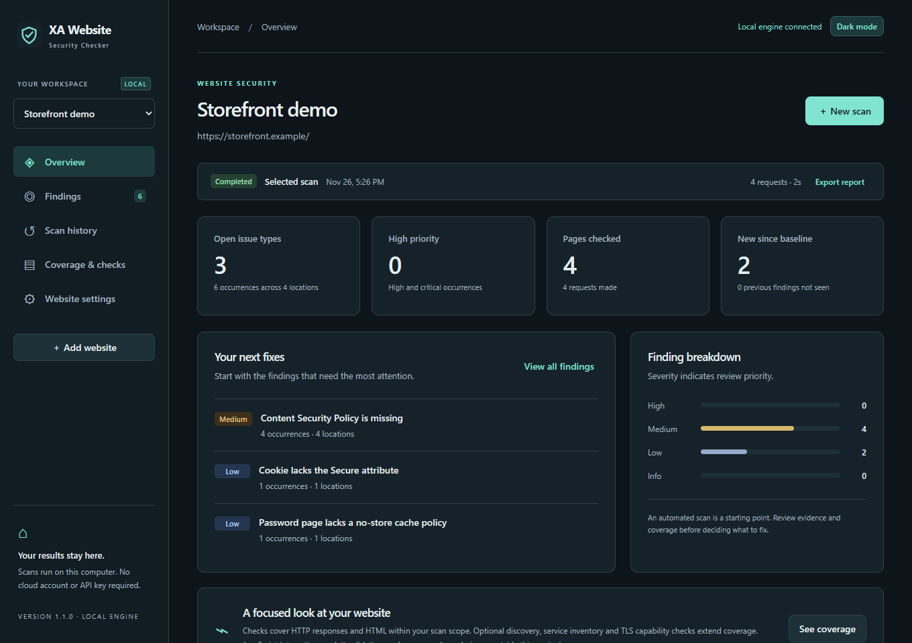
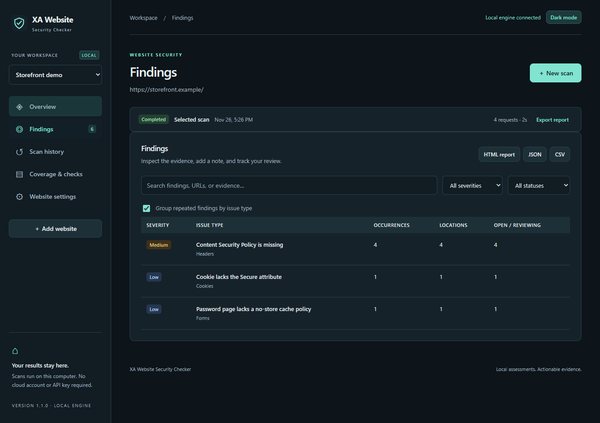
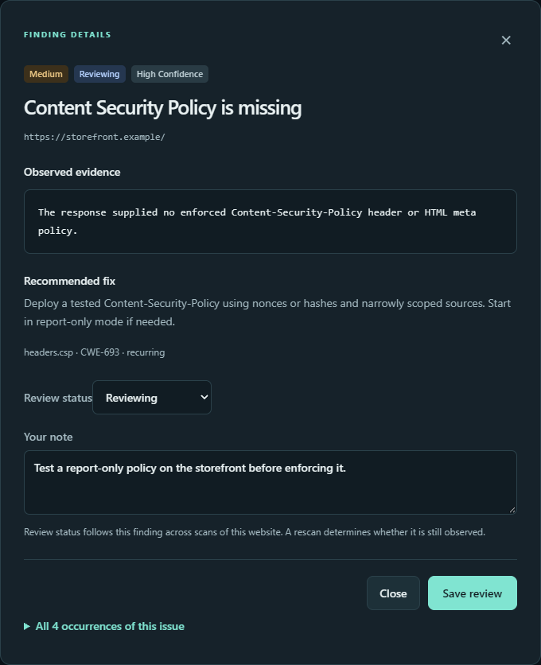

# XA Website Security Checker

Review the security headers, cookies, forms, and TLS configuration of a website you manage. The local dashboard groups repeated findings, shows the evidence behind each one, and compares results across scans. Requires Python 3.10 or newer and uses only the standard library.

## Quick start

1. On Windows, double-click **Start XA Website Security Checker.cmd**. You can also run `python start.py` from the project folder.
2. Open **http://127.0.0.1:8765/** and choose **Try a local demo** to explore the workflow with a synthetic website on your computer.
3. To check your own site, choose **Add website**, enter its final URL, and open **Website settings** to set the allowed paths and exclusions. Choose **New scan** to begin. Keep the console open while using the dashboard and press **Ctrl+C** there to stop it.

## Example scan

These screenshots use invented records for `storefront.example`. The overview shows six occurrences across four pages. Two occurrences are new since the previous comparable scan.



**Findings** groups repeated issues so you can see which fix affects the most pages. In this example, one missing Content Security Policy accounts for four occurrences.



Open an occurrence to see the **observed evidence** and **recommended fix**. Review status and notes follow that occurrence across scans.



## Coverage and reports

| Feature | What it covers |
| --- | --- |
| Default scan | Checks same-origin HTTP responses and HTML for header, cookie, form, content, and transport issues. Defaults to 30 pages, depth 3, and two requests per second. |
| Optional checks | Enhanced mode raises the page limit to 200 and enables sitemap discovery and exposure checks. TCP reachability and TLS protocol checks are separate options for infrastructure you have permission to test. |
| Review and export | **Coverage & checks** lists observed pages, evaluated rules, and errors. **Scan history** compares compatible runs. Export HTML or JSON for full scan context, or CSV for findings. |

Scan only sites you own or have permission to assess. Exclude routes where a GET request can change data. The scanner reads responses and HTML. JavaScript interactions and signed-in workflows that require a browser need separate review.

## Local data and CLI

The dashboard listens on loopback and stores history in `data/website-tester.sqlite3`. Optional authentication headers stay in memory for the scan and require verified HTTPS. Reports can contain paths, page titles, and review notes. To back up history, stop the app and copy the entire `data/` folder. Git excludes local scan data and exports by default.

For a one-off scan, run the command below with your own URL. It prints JSON and keeps dashboard history separate. Use `python start.py --help` for options or `python -B -m unittest discover -s tests` to run the test suite.

```powershell
python start.py --scan https://your-site.example/ --max-pages 10
```
